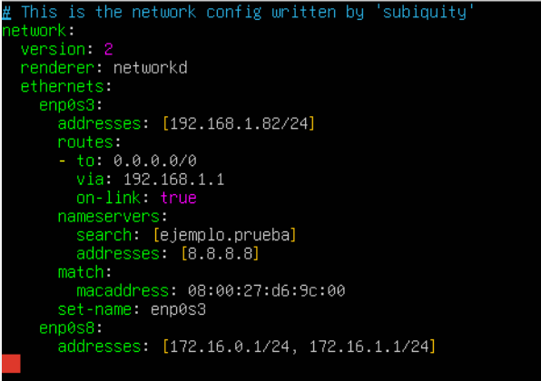
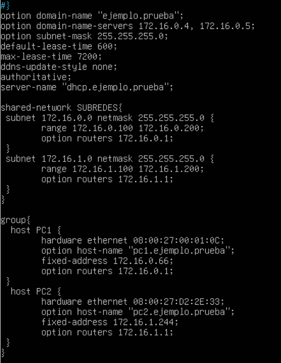
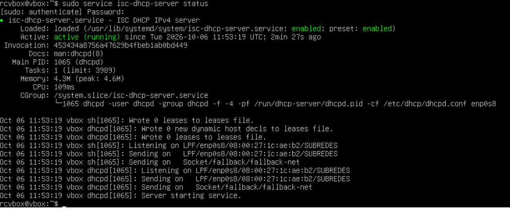
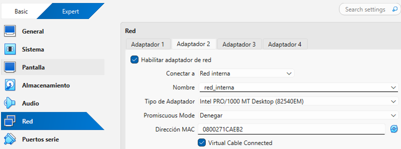
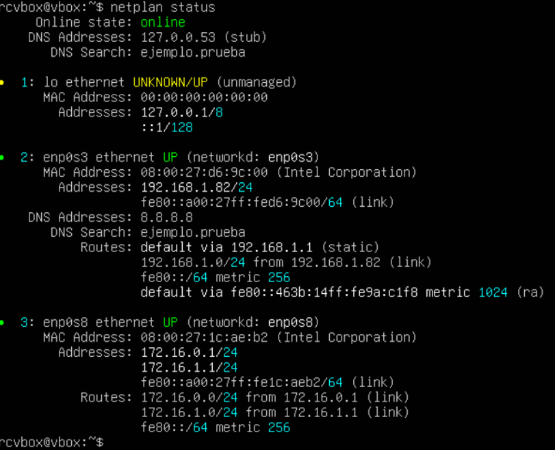
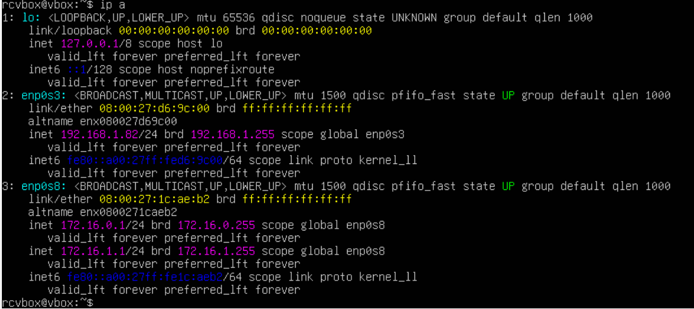
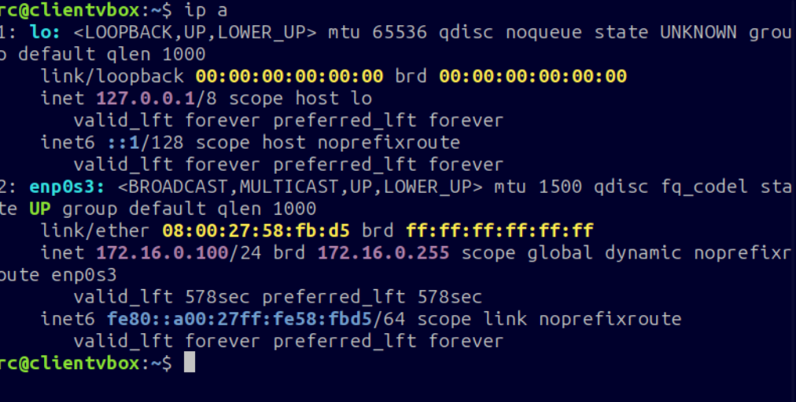
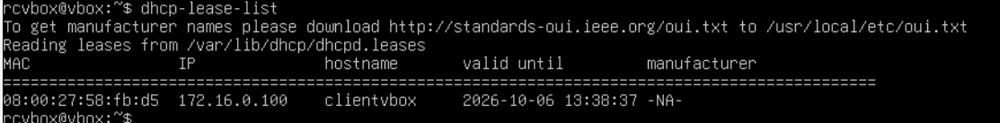

# **Configuración DHCP Ubuntu Server**

### **Objetivo**

Laboratorio en VirtualBox que consiste en configurar el servicio DHCP en el servidor Ubuntu Server. Contiene dos interfaces de red: enp0s3 (red externa) y enp0s8 (red interna). El objetivo es que un cliente conectado a la red interna reciba su IP de forma automática dentro de un rango especificado y que el servidor muestre esa concesión. 

### **Escenario:**
- Servidor autoritativo que NO permita actualizaciones DNS. Nombre de dominio “ejemplo.prueba”.
- Tiempo de concesión por máximo 2 horas.
- Servidores DNS: 172.16.0.4 y 172.16.0.5
- Tendrá 2 subredes:
	- Subred 1: Rango: 172.16.0.100 – 172.16.0.200; gateway 172.16.0.1;
	máscara 255.255.255.0
 	- Subred 2: Rango: 172.16.1.100 – 172.16.1.200; gateway 172.16.1.1;
	máscara 255.255.255.0
- Reservas:
	- PC1: MAC 08:00:27:00:01:0C; IP 172.16.0.66; gateway 172.16.0.1
	- PC2: MAC 08:00:27:D2:2E:33; IP 172.16.1.244; gateway 172.16.1.1

### **Entorno**

| **Adaptador en VirtualBox** | **Interfaz en Ubuntu** | **Tipo de conexión** | **Función** |
|---|---|---|---|
| Adaptador 1 | enp0s3 | Adaptador puente | Salida a la red externa (router 192.168.1.1) |
| Adaptador 2 | enp0s8 | Red interna | 172.16.0.1/24 y 172.16.1.1/24 (puertas de enlace de las 2 subredes) |
						  			
### **Instalación del servicio**

Para poder configurar el servidor DHCP, primero tuve que instalar el servicio DHCP mediante el comando ***`sudo apt install isc-dhcp-server`***.

### **Proceso de configuración**

### **1. Configuración del archivo .yaml**

En este archivo hay que configurar dos tarjetas de red: una externa (enp0s3) y otra para la red interna (enp0s8). 

En la tarjeta enp0s3 hay que indicar la IP fija del servidor para que no cambie cada vez que éste se reinicie. También, hay que indicar la IP gateway para poder acceder a la red exterior. La IP 0.0.0.0/0 es la ruta por defecto, en caso de que la IP a la que queremos conectarnos no la conozca, se envía a través del router (192.168.1.1).

Debemos también indicar el servidor de dominio y la IP pública que va a utilizar.

En la tarjeta enp0s8 hay que indicar las IPs que van a actuar como puerta de enlace y que van a utilizar los dispositivos que forman parte de la red interna. Estas IPs también deberán indicarse en el archivo dhcpd.conf en el pool correspondiente. 

### **2. Configuración del archivo dhcpd.conf**

El servicio DHCP asigna IPs de forma automática a los dispositivos de la red que lo soliciten. Para repartir estas direcciones, la interfaz del servidor debe poseer previamente una IP estática en esa misma subred. La configuración del archivo dhcpd.conf define parámetros globales, subredes, pools dinámicos, duración de las licencias.

En este caso, hay 2 IPs estáticas que corresponden a unos dispositivos que se pueden identificar por su dirección MAC. De esta forma nos aseguramos de poder asignar IPs fuera de rango dinámico a dispositivos concretos. 

Las IPs se entregan con licencias de duración limitada. Si el cliente se mantiene encendido o activo en la red, pide de forma automática al servidor la renovación de la licencia antes de que esta caduque. Si el cliente se desconecta de la red, la licencia caduca y la IP vuelve al pool. El max-lease-time indica el tiempo máximo por concesión, si el cliente necesita más deberá solicitar la renovación. 

### **3. Comprobación de que funciona el servidor - Troubleshooting**

Tuve un problema con este paso porque se me olvidó activar el segundo adaptador en la configuración de la máquina virtual. 

Me di cuenta porque al utilizar el comando ***`service isc-dhcp-server status`*** me salía *‘Active: failed (exit code)’*. 

Para intentar solucionarlo, primero comprobé que reconociera las dos tarjetas de red usando el comando ***`netplan status`*** pero en un principio solo me aparecía enp0s3. Cuando activé el adaptador funcionó sin problemas.

Sin el adaptador 2 no existía enp0s8, así que ninguna interfaz del servidor tenía una IP dentro de las subredes declaradas en dhcpd.conf. El servicio no tenía dónde escuchar y terminó con error.

Utilicé el comando ***`netplan status`*** porque este comando muestra el estado actual de las interfaces de red del sistema, y me sirvió para detectar que no estaba reconociendo la segunda interfaz (enp0s8). El comando ***`ip a`*** me muestra la información de red de cada interfaz, esto confirmó que ambas interfaces funcionaban perfectamente y tenían asignadas IPs correctas. 

### **4. Configuración en un cliente**

El cliente se conecta a la red interna y recibe de forma automática la IP dentro del rango especificado. El servidor asigna las IPs del rango que pertenezca a la subred por la que recibe la petición. Como la MAC del cliente es diferente a las 2 especificadas en el documento dhcpd.conf, no se asignará ninguna de las IPs fijas, sino que se asignará la primera disponible del rango del pool correspondiente. En este caso se asignó la 172.16.0.100/24.

Utilizando el comando ***`dhcp-lease-list`*** podemos comprobar que se ha hecho la concesión de IP correctamente y podemos también comprobar cuántos dispositivos han sido concedidos una IP y cuándo caduca cada concesión. 

