# **SSH: instalación y configuración básica de seguridad**

### **Objetivo**
Laboratorio en VirtualBox que consiste en configurar el servicio openssh en el servidor Ubuntu Server. Aplicar medidas de seguridad básicas para la conexión en remoto desde un dispositivo cliente mediante el protocolo ssh.

### **Escenario:**

- VirtualBox
- Ubuntu Server 26.04
- Windows 11

### **Proceso de configuración**

El primer paso fue comprobar la IP del servidor para asegurarme de que tuviese una IP correctamente configurada y que se encuentre activa. Para ello utilicé el comando ***`ip a`***, que me devuelve toda la información de las tarjetas de red que tenga habilitadas el servidor junto a la información de cada una como IP, puerta de enlace, dirección MAC, dirección de broadcast.

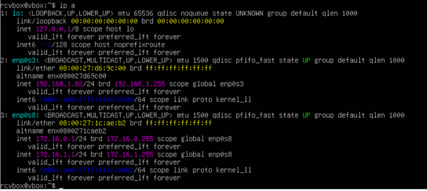

El siguiente paso fue configurar el firewall para habilitar el puerto 22 para poder conectarme desde el equipo cliente por el puerto por defecto del protocolo ssh. Para ello utilicé el comando ***`sudo ufw allow 22/tcp`***. Así como el comando ***`sudo ufw enable`*** para habilitar el firewall. 

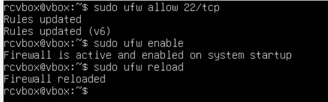

Una vez configurado el firewall con el puerto correspondiente, inicié el proceso de instalación del servicio openssh. Cuando intenté instalarlo me devolvió que ya estaba instalado, por lo que me limité a comprobar el estado del mismo mediante el comando ***`sudo systemctl status ssh`*** que salía inactivo. 

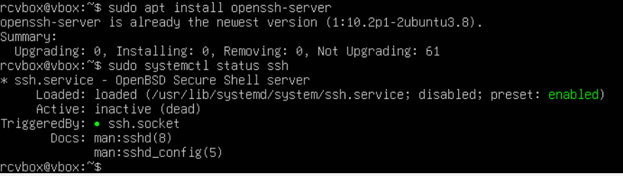

Para activarlo utilicé el comando ***`sudo systemctl enable --now ssh`*** y volví a comprobar el estado para asegurarme de que había funcionado correctamente. 

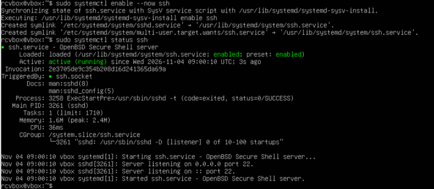

Una vez activo, comprobé que el servidor estaba escuchando por el puerto correcto (22) para poder conectarme de forma remota desde el cliente mediante el comando ***`sudo ss -tlnp | grep ssh`***. 

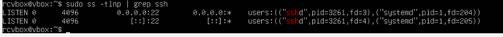

Intenté conectarme al servidor desde mi ordenador Windows 11 utilizando el comando ssh (***`ssh usuario@IP`***) y no hubo ningún problema de conexión.

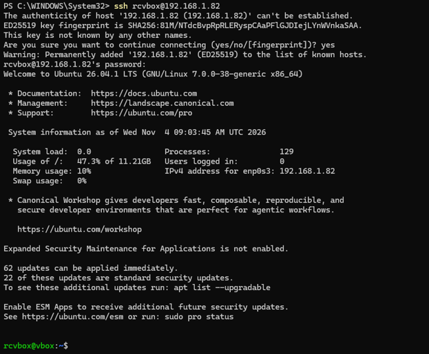

Hice algunas comprobaciones básicas para asegurarme de que estaba en la máquina adecuada utilizando comandos como whoami o hostname.

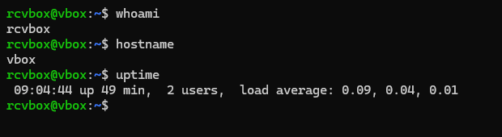

### **Implementación de medidas básicas de seguridad**

Quería cambiar el puerto de conexión ssh para no utilizar el que viene por defecto. Para ello, actualicé el archivo sshd_config y cambié el puerto de conexión del 22 a 2222 y también denegué el permiso de conexión con root.  

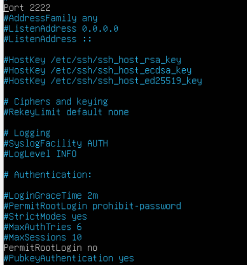

Intenté volver a conectarme desde el cliente, pero no se pudo establecer la conexión. 
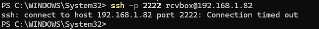

### **Troubleshooting**

Consulté cuál era el puerto por el que estaba escuchando el servidor y me di cuenta de que no se había modificado como esperaba. El servidor seguía escuchando por el puerto 22. 
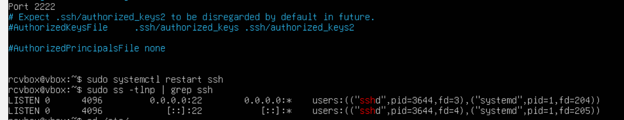

Para intentar solucionarlo, recargué la configuración de systemd y reinicié ssh.socket. Systemd lee los archivos de configuración al arrancar el sistema o al ejecutar el comando daemon-reload. Al recargar el systemd, ya reconoce el nuevo puerto. En esta versión de Ubuntu, el servicio que mantiene abierto el puerto es ssh.socket, por lo que me faltaba reiniciar ssh.socket para que también empezase a escuchar por el nuevo puerto.

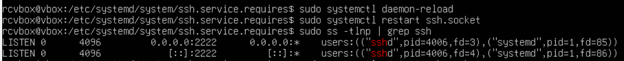

A pesar de que el servidor estaba bien configurado para escuchar por el puerto correcto, la conexión desde el host seguía fallando. 

 
Me di cuenta de que el problema era el firewall. No había cambiado el puerto permitido en él por lo que cuando intentaba conectarme, el firewall lo bloqueaba.
Comprobé los logs del firewall de la última hora usando el comando ***`sudo journalctl --since '1 hour ago' | grep -i ufw`*** y me di cuenta de que el firewall había estado bloqueando la conexión. 

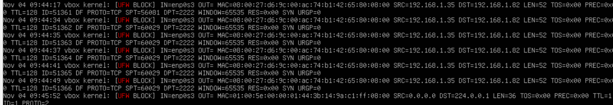

Añadí la nueva regla para que permitiese la conexión desde ese puerto (2222).

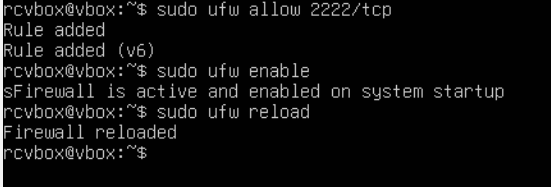

Comprobé que apareciera el cambio en los logs del firewall.

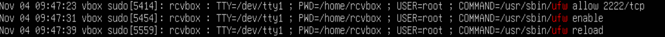

Volví a intentar conectarme utilizando el comando ***`ssh -p 2222 usuario@IP`*** desde el host en ese puerto y lo conseguí. 

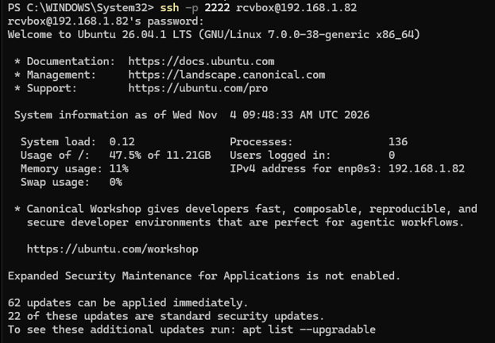

También quise comprobar que la prohibición de inicio de sesión con root funcionaba, por lo que intenté iniciar sesión con root en el puerto 2222 y se me denegó el acceso. 

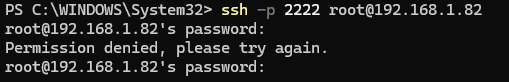

Una vez que el puerto 2222 estaba abierto y funcionaba la conexión, tuve que cerrar el puerto 22 porque ya no lo iba a usar. Para ello comprobé el estado actual del firewall utilizando el comando ***`sudo ufw status`***.

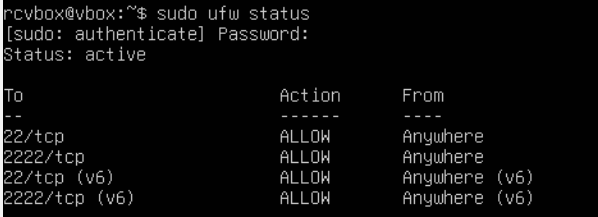

Utilicé el comando ***`sudo ufw deny 22/tcp`*** para cerrar el puerto 22 y volví a comprobar el estado para asegurarme de que se había cerrado. 

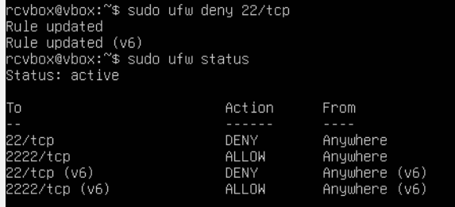

